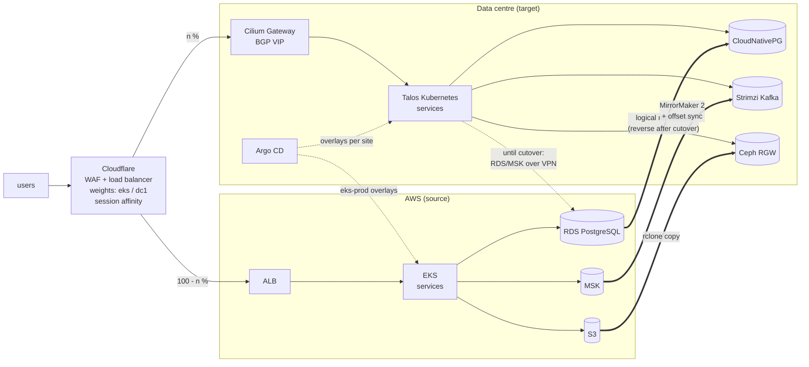

# eks-to-onprem-repatriation

[](https://github.com/ozy31/eks-to-onprem-repatriation/actions/workflows/ci.yml)


A complete, phased plan and the code to move a production platform from
Amazon EKS and AWS managed services to Kubernetes on owned hardware, without a
big-bang cutover and with a rollback at every step.

- **Cluster:** Talos Linux, Cilium (native routing, BGP, Gateway API), Argo CD
- **Storage:** Ceph via Rook for block, file and S3
- **Data stores:** CloudNativePG instead of RDS, Strimzi Kafka instead of MSK,
  OpenBao + External Secrets instead of Secrets Manager
- **Data moves:** PostgreSQL logical replication with a reverse path for
  rollback, MirrorMaker 2 with consumer offset sync, rclone for buckets,
  Velero data mover for volumes
- **Traffic:** a Cloudflare load balancer shifts sessions between the sites in
  steps, with session affinity and health-based failover
- **Decision:** a TCO model that gates the whole thing on the payback period

It builds on [terraform-aws-eks-platform](https://github.com/ozy31/terraform-aws-eks-platform)
(the EKS side), [gitops-multicluster-dr](https://github.com/ozy31/gitops-multicluster-dr)
(Argo CD across clusters) and [terraform-cloudflare-edge](https://github.com/ozy31/terraform-cloudflare-edge)
(the edge both sites share).

> Hostnames, account IDs and addresses are placeholders (`example.com`, RFC 5737 / RFC 1918 ranges).
> The TCO numbers are illustrative.

## Contents

- [Architecture](#architecture)
- [Phases](#phases)
- [Repository layout](#repository-layout)
- [The cost case](#the-cost-case)
- [Design decisions](#design-decisions)
- [Validation](#validation)

## Architecture



One Argo CD instance deploys to both clusters. A service runs at a site when
`workloads/<service>/overlays/<site>/` exists, so moving a service is a pull
request, and while both overlays exist the load balancer weights decide who
serves the traffic.

## Phases

| Phase | What happens | Rollback |
|---|---|---|
| 0. Foundations | Hardware, BGP to the ToR switches, VPN to the VPC, Talos cluster | n/a |
| 1. Platform | Cilium, Ceph, cert-manager, OpenBao, operators; replication of every data store starts | Delete the new cluster |
| 2. Stateless traffic | Services run at both sites; dc1 share goes 1 -> 5 -> 25 -> 50 % | Previous weight, one apply |
| 3. Stateful cutover | Per data store, in a short window: drain lag, switch writers | Reverse replication; switch the secret back |
| 4. Decommission | 100 % on-prem, EKS/RDS/MSK deleted after the rollback window | Rebuild from git and backups |

The full procedure, with exit checks per phase: [docs/runbook.md](docs/runbook.md).
What replaces each AWS service: [docs/service-mapping.md](docs/service-mapping.md).

## Repository layout

| Path | Contents |
|---|---|
| [`talos/patches`](talos/patches) | Talos 1.14 machine config patches: no Flannel/kube-proxy, kubelet reservations, audit policy, storage node labels and taints |
| [`platform/components`](platform/components) | One directory per platform component: pinned chart (`config.yaml`) + values. Cilium, Rook/Ceph, cert-manager, External Secrets, OpenBao, CloudNativePG + Barman Cloud, Strimzi, Velero, external-dns, Argo CD |
| [`platform/manifests`](platform/manifests) | BGP peering and LoadBalancer IP pools, the shared Gateway, issuers, secret stores, Velero's bucket |
| [`platform/bootstrap`](platform/bootstrap) | AppProjects and ApplicationSets: platform components, per-site workloads, migration resources |
| [`workloads/orders`](workloads/orders) | Example service with an `eks-prod` overlay (IRSA, Secrets Manager, ALB) and a `dc1-prod` overlay (OpenBao, Gateway API, on-prem endpoints) |
| [`migration/postgres`](migration/postgres) | CloudNativePG cluster, schema import, subscription to RDS, backups, `rds-source.sql`, `cutover.sh`, rollback publication |
| [`migration/kafka`](migration/kafka) | KRaft Kafka cluster and MirrorMaker 2 from MSK with identity topic names and offset sync |
| [`migration/objects`](migration/objects) | Bucket claim on Ceph RGW and the rclone copy job |
| [`migration/velero`](migration/velero) | EKS-side Velero values and schedule (CSI snapshots + data mover), dc1 restore with storage class and metadata rewrites |
| [`terraform/traffic-shift`](terraform/traffic-shift) | Cloudflare load balancer, pools and health checks; `dc1_traffic_percent` drives the migration |
| [`tools/tco`](tools/tco) | Cost model: run rate per site, migration cost, payback month |
| [`docs/adr`](docs/adr) | Architecture decision records |

## The cost case

```console
$ python3 tools/tco/tco.py tools/tco/example.toml
Cloud run rate                    $99,000/month
On-prem run rate                  $61,312/month
  hardware (amortized)            $15,033
  colocation                      $10,000
  power                           $4,579
  staff                           $22,000
  IP transit (2 carriers)         $3,200
  hardware support contracts      $4,100
  Cloudflare (LB, WAF, Tunnel)    $1,500
  off-site backup copy            $900
Hardware (capex)                  $902,000
Move (one-off + dual running)     $774,000
Payback in month                  19
3-year total                      stay $3,932,280, move $2,981,228, difference $951,052
5-year total                      stay $7,252,859, move $4,452,714, difference $2,800,145
```

The model counts what is usually left out: the staff to run the new platform,
the months both sites are paid for, support contracts and an off-site backup
copy. If the payback is not clearly inside the hardware's life, the answer is
to stay and optimise ([ADR 1](docs/adr/0001-repatriate-steady-workloads.md)).

## Design decisions

**Replicate first, move traffic second, move writes last.** Every data store
is replicating to the data centre before any user traffic arrives there. In
phase 2 the on-prem services still write to RDS and MSK over the VPN, so the
traffic shift and the data cutover are separate risks with separate rollbacks.

**A rollback that is cheaper than going forward.** Traffic: one Terraform
variable. PostgreSQL: right after the cutover, RDS subscribes to the new
cluster, so going back is a secret change rather than a restore
([ADR 5](docs/adr/0005-postgres-logical-replication.md)).

**Engine-native replication over generic copy tools.** Logical replication
for PostgreSQL, MirrorMaker 2 for Kafka (topic names and consumer offsets
preserved), rclone for objects. Velero only moves volumes that have no
replication of their own, through CSI snapshots and its data mover, because
EBS snapshots cannot be restored onto Ceph.

**Placement is a directory.** `overlays/eks-prod` and `overlays/dc1-prod` show
exactly what differs between the sites: identity (IRSA vs. none), secret store
(Secrets Manager vs. OpenBao), ingress (ALB vs. Gateway API) and endpoints.
The base stays identical, so "works on EKS, breaks on-prem" has a short list
of suspects.

**Session affinity during the dual-site phase.** A user stays on one site for
30 minutes. Without it, a write on one site followed by a read on the other
exposes replication lag as a bug ([ADR 4](docs/adr/0004-cloudflare-weighted-traffic-shift.md)).

**No cloud credentials on-prem.** IRSA annotations are stripped on restore,
on-prem service accounts have no token mounted unless they need one, and the
only AWS keys in the data centre are read-only migration users that are
deleted in phase 4.

**Immutable nodes.** Talos has no SSH and no package manager; node config is
reviewed and validated like the rest of the code
([ADR 2](docs/adr/0002-talos-linux.md)).

**One storage system.** Ceph replaces EBS, EFS and S3 with one operational
model and host-level failure domains ([ADR 3](docs/adr/0003-ceph-via-rook.md)).

## Validation

```bash
make check      # everything below
make manifests  # kubeconform against Kubernetes 1.37 + the pinned CRD schemas,
                # including every rendered Helm chart and both overlays
make talos      # generate the machine configs and talosctl validate --mode metal
make terraform  # fmt + validate
make tco        # unit tests + example
```

`hack/crds.txt` pins the CRDs of every operator in use; `hack/schemas.sh`
turns them into JSON schemas so a typo in a CloudNativePG, Strimzi, Rook,
Cilium or Argo CD resource fails CI instead of failing a sync.

## License

MIT
